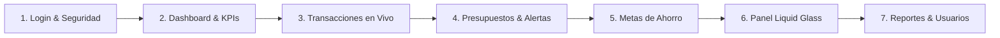

# Guía de Pruebas y Demostración en Vivo · FinanzasCardenas

> **Propósito:** Documento de apoyo para la sustentación y presentación en vivo del proyecto de software. Contiene el guion cronológico exacto paso a paso, los resultados visuales esperados y las respuestas estratégicas a preguntas comunes del comité evaluador.

---

## 1. Requisitos Previos del Sistema

Para ejecutar la demostración en vivo, la máquina de exposición debe cumplir con uno de los siguientes dos entornos:

### Opción A: Demostración con el Binario Portable Windows (`.exe`)
* **Sistema Operativo:** Windows 10 o Windows 11 (64 bits).
* **Dependencias:** Ninguna (el archivo es autónomo, sin instaladores ni necesidad de Node.js).
* **Ubicación:** `dist/FinanzasCardenas-0.1.0-portable.exe` (o copiado en una memoria USB).

### Opción B: Demostración en Modo Desarrollo (macOS / Linux / Windows)
* **Node.js:** Versión `>= 22.0.0` (LTS recomendada).
* **npm:** Versión `>= 10.0.0`.
* **Espacio en disco:** ~500 MB para `node_modules` y dependencias locales.

---

## 2. Preparación y Arranque de la Aplicación

### Paso 1: Verificar Datos de Demostración
Antes de iniciar la exposición, confirma que la base de datos cuenta con los 159 movimientos del histórico semestral:
```bash
cd finanzas-cardenas
node scripts/seed-demo.js
```
*(Si ya fue ejecutado previamente, el comando es idempotente y sincronizará las metas, presupuestos y agregados automáticamente).*

### Paso 2: Iniciar la Aplicación
* **En Windows (Ejecutable):**
  Doble clic sobre `FinanzasCardenas-0.1.0-portable.exe`.
* **En Entorno de Desarrollo (macOS/Linux):**
  ```bash
  cd finanzas-cardenas
  npm start
  ```

---

## 3. Credenciales de Acceso para la Presentación

FinanzasCardenas almacena la seguridad del hogar mediante contraseñas cifradas con algoritmo de derivación de claves `scrypt`.

| Rol | Usuario por Defecto | Contraseña | Notas de Demostración |
| :--- | :--- | :--- | :--- |
| **Administrador** | `Jacobo_Cardenas` | `[ Tu contraseña maestra ]` | Tiene acceso total a métricas, configuraciones y usuarios. |
| **Editor (Demo)** | *(Se crea en vivo)* | `[ Temporal de 1 uso ]` | Demuestra el control de acceso por roles (RBAC). |

> ✍️ **Espacio para tus anotaciones personales antes de subir al podio:**
> * **Usuario:** ________________________________________
> * **Contraseña:** ________________________________________

---

## 4. Guion de Demostración en Vivo (Paso a Paso)

Sigue esta secuencia cronológica durante tu exposición para demostrar la solidez técnica, funcional y visual del software:



---

### Escena 1: Autenticación, Seguridad y Sesión
1. **Mostrar la pantalla de bienvenida:** Explica la estética *Liquid Glass* (vidrio esmerilado translúcido, gradientes Apple y tipografía moderna).
2. **Prueba de Error Controlado:**
   * Ingresa un usuario o contraseña errónea intencionalmente y presiona *Iniciar sesión*.
   * **Resultado esperado:** Aparece un mensaje de validación accesible indicando credenciales inválidas y el número de intentos restantes (máximo 5 antes del bloqueo de cuenta).
3. **Inicio de Sesión Exitoso:**
   * Ingresa con el usuario Administrador y contraseña correcta.
   * **Resultado esperado:** Transición fluida con esqueleto de carga (*skeleton loaders*) sin parpadeos blancos, aterrizando directamente en el Panel de Control.

---

### Escena 2: Panel de Control (Dashboard Financiero)
1. **Explicar las Tarjetas KPI:**
   * **Balance Total:** Muestra el saldo neto acumulado en pesos colombianos (`$ COP`) con formateo regional oficial `es-CO` sin decimales espurios.
   * **Ahorro Mensual:** Muestra el superávit/déficit calculado en tiempo real (Ingresos − Gastos).
2. **Demostrar los Gráficos Nativos SVG Accesibles:**
   * **Gráfico de Barras:** Evolución histórica de ingresos y gastos de los últimos 6 meses.
   * **Gráfico de Líneas:** Tendencia del margen de ahorro neto en 12 meses.
   * **Gráfico de Pastel:** Distribución porcentual del gasto del mes actual por categorías.
3. **Demostración de Accesibilidad en Gráficos:**
   * Pasa el ratón sobre una barra o segmento para ver el tooltip dinámico.
   * Presiona la tecla `Tab` para enfocar los gráficos y navega con las flechas del teclado (`←` / `→`) para demostrar el cumplimiento con la directiva WCAG 2.1 AA.

---

### Escena 3: Módulo de Transacciones (Operaciones en Tiempo Real)
1. **Navegar a Transacciones:** Haz clic en *Transacciones* en la barra lateral o presiona el atajo de teclado correspondiente.
2. **Explorar el Historial:**
   * Muestra las pestañas superiores: *Todos*, *Gastos*, *Ingresos*.
   * Demuestra el ordenamiento haciendo clic en el encabezado de las columnas (Fecha, Monto, Categoría).
   * Usa el buscador en vivo escribiendo por ejemplo `"Éxito"` o `"Gasolina"` para ver el filtrado instantáneo.
3. **Registrar un Gasto en Vivo:**
   * Clic en el botón **"+ Nuevo movimiento"**.
   * Llena los campos:
     * **Tipo:** Gasto.
     * **Categoría:** *Alimentación*.
     * **Monto:** `45.000` (resalta que el input autocompleta el formato de moneda COP).
     * **Fecha:** Fecha actual.
     * **Descripción:** `Almuerzo de trabajo con el profesor`.
   * Clic en **"Guardar"**.
   * **Resultado esperado:** Cierre del modal, notificación toast de confirmación y aparición inmediata de la fila en la tabla con color distintivo y signo negativo.

---

### Escena 4: Presupuestos y Monitoreo de Gastos
1. **Navegar a Presupuestos:** Clic en *Presupuestos* en la barra de navegación.
2. **Explicar los Estados de Alerta:**
   * **Alimentación (🚨 SUPERADO / Over):** La barra supera el 100% y se ilumina en rojo vibrante. Explica que esto ayuda al usuario a frenar gastos desmedidos.
   * **Transporte (⚠️ ALERTA / Warning):** La barra está entre el 80% y el 100%, con indicador ámbar de advertencia preventiva.
   * **Vivienda y Servicios (✅ OK):** Barras en color cian/azul con consumo saludable (< 80%).
3. **Ajuste de Presupuesto:**
   * Modifica el presupuesto de *Alimentación* para ampliarlo a un valor superior al gasto actual.
   * **Resultado esperado:** La barra cambia dinámicamente de estado "Superado" a "OK" sin requerir recargar la página.

---

### Escena 5: Metas de Ahorro y Anillos de Progreso
1. **Navegar a Metas:** Clic en *Metas de ahorro*.
2. **Mostrar las Metas Existentes:**
   * Destaca los anillos de progreso SVG interactivos:
     * *Viaje a San Andrés* (64% completado).
     * *Fondo de emergencia* (50% completado).
     * *Computador nuevo* (45% completado).
3. **Registrar un Aporte en Vivo:**
   * En la tarjeta *Computador nuevo*, haz clic en el botón con ícono de alcancía **"Aportar"**.
   * Ingresa un monto de `$ 500.000` COP y confirma.
   * **Resultado esperado:** El anillo SVG se anima aumentando su arco visual de 45% a 57.5% de forma instantánea.

---

### Escena 6: Personalización Visual "Liquid Glass" (Apple Style)
1. **Abrir el Cajón Deslizante (Offcanvas):**
   * Haz clic en el botón flotante inferior derecho con la etiqueta **"Panel"** (o desde el menú de usuario > *Apariencia de la app*).
   * **Resultado esperado:** El Drawer lateral se desliza suavemente sobre un telón difuminado tipo *backdrop blur*.
2. **Demostración de Opciones de Diseño:**
   * **Temas de Color (12 Paletas):** Cambia de *Firma* a *Solar* (ámbar), *Esmeralda* o *Índigo*. Todas las variables CSS del sistema reaccionan en tiempo real.
   * **Modos de Luz (4 Modos):** Cambia entre *Oscuro*, *Claro* y *Alto Contraste*.
   * **Geometría (12 Tipos):** Alterna el radio de bordes de *Redondeado fluido* a *Cápsula* o *Recto técnico*.
   * **Fondos Dinámicos (12 Fondos):** Muestra el efecto de refracción seleccionando *Aurora boreal*, *Nebulosa cósmica* o *Gradiente fluido*.
   * **Accesibilidad:** Muestra los filtros para daltonismo (Protanopía, Deuteranopía, Tritanopía) y el control deslizante de escala de texto.
3. **Comprobación de Persistencia:**
   * Cierra el panel y presiona `Cmd+R` / `Ctrl+R` para recargar.
   * **Resultado esperado:** El tema y las preferencias elegidas persisten intactas gracias a `LocalStorage` encriptado/aislado por usuario.

---

### Escena 7: Reportes, Exportación y Administración de Usuarios
1. **Módulo de Reportes:**
   * Navega a *Reportes*.
   * Haz clic en **"Exportar CSV"**.
   * **Resultado esperado:** Se abre el diálogo nativo del sistema operativo (Windows Explorer o macOS Finder) para elegir dónde guardar el archivo `.csv`, incluyendo codificación UTF-8 con BOM para apertura perfecta en Excel.
2. **Gestión de Miembros del Hogar (Rol Administrador):**
   * Navega a *Usuarios*. Explica que esta sección **solo es visible para el Administrador**.
   * Clic en **"+ Nuevo usuario"**.
   * Crea un usuario con rol *Editor*:
     * Usuario: `carlos`
     * Nombre: `Carlos Asistente`
     * Contraseña temporal: `Clave-Temporal-2026!`
   * **Resultado esperado:** El sistema crea el usuario y marca la bandera `mustChangePassword = 1`, forzando a que en su primer inicio deba cambiar obligatoriamente la clave.

---

## 5. Preguntas Frecuentes y Respuestas Técnicas para el Evaluador

Prepárate con estas respuestas claras ante posibles preguntas del jurado o profesor:

### ¿Dónde y cómo se almacenan los datos financieros?
> **Respuesta:**
> *"La aplicación utiliza SQLite a través de la librería `better-sqlite3`, una de las más rápidas del ecosistema Node.js. La base de datos relacional reside localmente en la carpeta de datos del usuario (`userData/data/finanzas.db`), operando bajo el modo WAL (Write-Ahead Logging). No se envía ningún dato financiero a la nube, garantizando 100% de privacidad familiar y funcionamiento total sin conexión a internet."*

### ¿Cómo manejan la seguridad de las contraseñas y qué pasa si el Admin la olvida?
> **Respuesta:**
> *"Utilizamos el algoritmo estándar `scrypt` con parámetros robustos ($N=32768, r=8, p=1$) y sales criptográficas únicas de 16 bytes. Si el administrador olvida su contraseña, el sistema no la resetea enviando correos inseguros; utiliza una Clave de Recuperación alfanumérica única generada en el primer inicio. Esta clave es de un solo uso: al usarse, se invalida y se genera una nueva de inmediato."*

### ¿Cómo garantizaron que la interfaz no sea vulnerable a inyecciones XSS?
> **Respuesta:**
> *"Implementamos una Política de Seguridad de Contenido (CSP) estricta: `default-src 'self'` sin `'unsafe-inline'`. No usamos `innerHTML` en ninguna parte del código; todas las vistas se construyen con funciones DOM declarativas que tratan los datos como texto puro (`textContent`), neutralizando cualquier vector de inyección de código malicioso."*

### ¿Por qué crearon un diseño personalizado en lugar de usar un framework como Bootstrap o Tailwind?
> **Respuesta:**
> *"Diseñamos la arquitectura 'Liquid Glass' basada en el sistema visual de Apple usando variables CSS nativas (`CSS Custom Properties`) y efectos de difuminación (`backdrop-filter`). Esto nos permite ofrecer 12 temas de color, 4 modos de iluminación y animaciones a 60 FPS con un peso de código mínimo, cero dependencias pesadas y tiempos de carga instantáneos."*

### ¿Qué pruebas avalan la calidad del código entregado?
> **Respuesta:**
> *"El proyecto cuenta con una batería automatizada con el runner nativo de Node.js 22: **256 pruebas unitarias y de integración**, **53 pruebas end-to-end de interfaz en Electron real** auditadas con `axe-core` para accesibilidad WCAG A/AA, y una **cobertura de código superior al 89%** en el global y sobre el 96% en los módulos financieros críticos."*

---

## 6. Solución Rápida de Imprevistos en la Presentación

Si ocurre algún inconveniente técnico durante la exposición, mantén la calma y aplica estas soluciones de contingencia:

| Situación | Causa Probable | Solución Inmediata |
| :--- | :--- | :--- |
| **La app no abre o dice "Port in use"** | Un proceso anterior de Electron quedó colgado en segundo plano. | Abre la terminal y ejecuta: <br>`killall Electron || pkill -f FinanzasCardenas` |
| **Los datos aparecen en blanco** | La base de datos no fue poblada en la ruta activa. | Ejecuta en terminal: <br>`node scripts/seed-demo.js` y recarga con `Ctrl+R`. |
| **La pantalla se congeló o se ve desalineada** | Caché visual del motor de renderizado Chromium. | Presiona el atajo de recarga: `Cmd+R` (macOS) o `Ctrl+R` (Windows). La sesión persiste en memoria. |
| **Olvidé la contraseña del Administrador** | Bloqueo o extravío de clave durante pruebas previas. | Ejecuta `node scripts/seed-demo.js` para sincronizar el acceso o usa la clave de recuperación de respaldo. |
